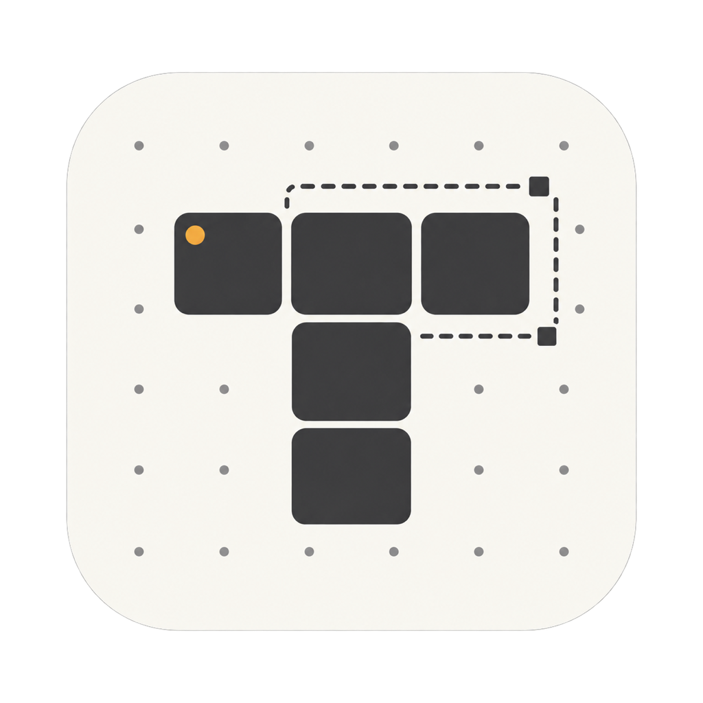
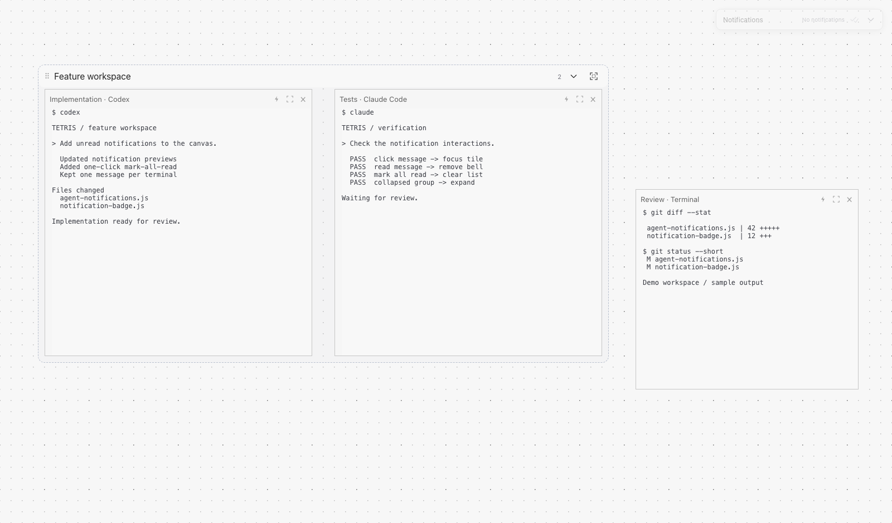
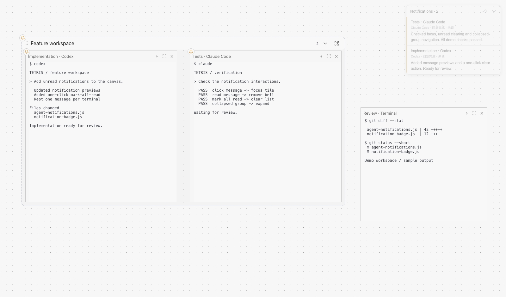
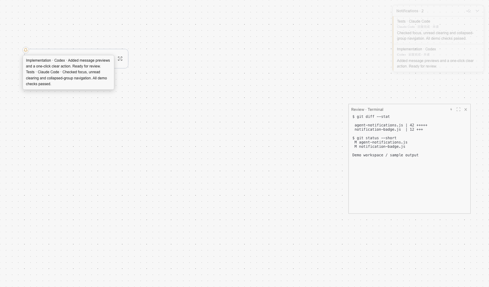
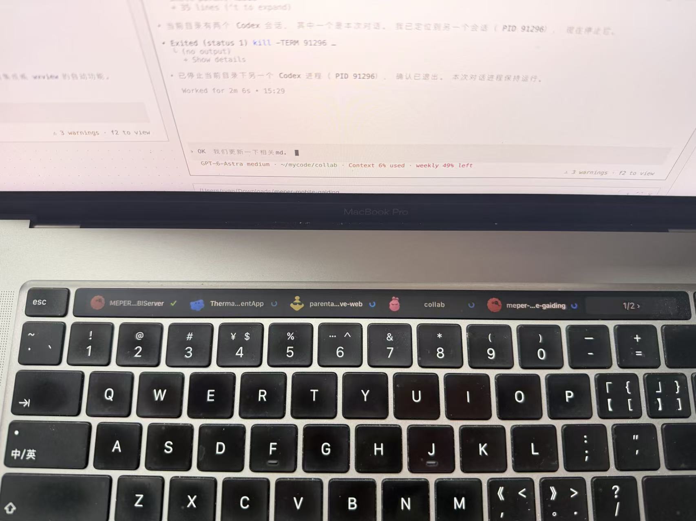
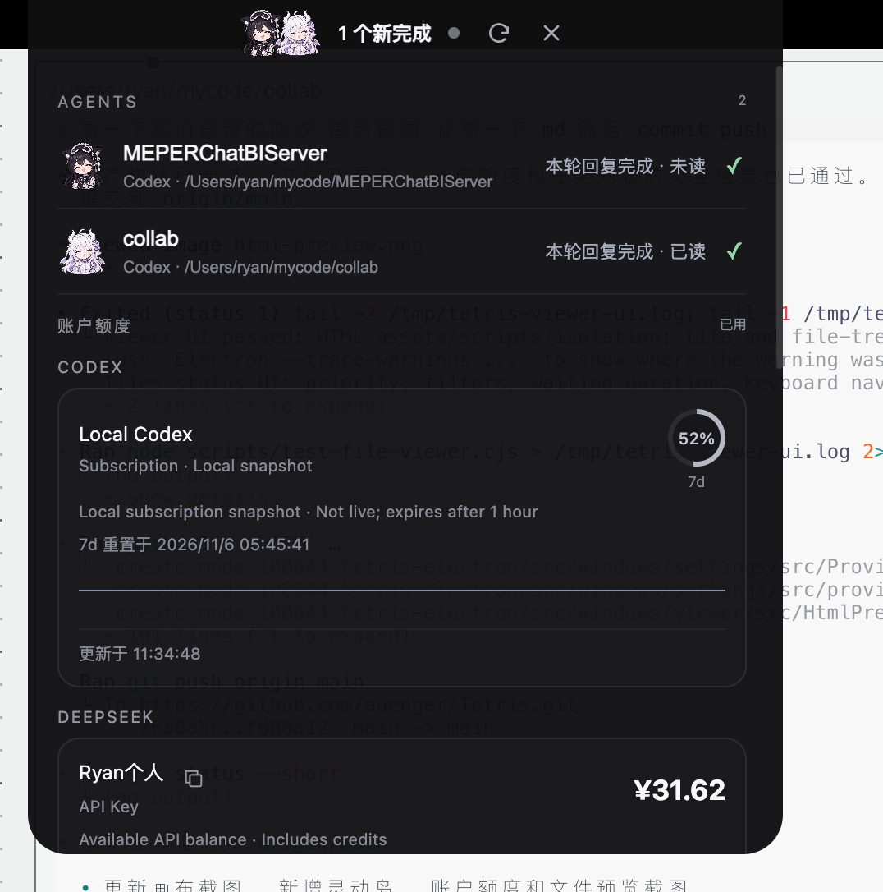

# Tetris

**Terminals, coding agents and project files on one canvas.**

[简体中文](README.md) · [User guide](docs/guide.en.md) · [Development](docs/development.md)

Tetris is a desktop workspace for parallel development tasks. A tile is a movable, resizable content window. Group related windows, collapse a task when you need room, and expand it when you are ready to continue.



> Canvas and notification screenshots render current production UI components with demo data and show the canvas area. Terminal text is sample content, not a record of live agent execution. See [screenshot notes](docs/screenshots/README.md) to reproduce them.

## Features

- **Spatial canvas**: arrange terminals, files and browser windows; pan, zoom, resize and navigate between tasks.
- **Collapsible groups**: select several windows and name a group. Move the group by its header, move members independently, resize its frame, drop windows into it, or create a window inside it to join automatically.
- **Agent completion previews**: Claude Code and Codex notifications include message content. Keep the latest notification per terminal, jump from the unread list, or mark everything read with one click.
- **On-demand file tree**: load folders as they expand. Use the refresh icon or F5 to refresh the active workspace tree manually.
- **Persistent terminals**: a separate PTY sidecar keeps sessions alive across normal app exits and reconnects them when the app reopens.

## Notifications and groups



An unread bell appears at the top-left of a terminal or group. Hover for the message; focusing the terminal removes its bell. The top-right list navigates to a terminal and removes the clicked notification. An icon button marks all messages read.



Collapsing a group hides its windows without stopping terminals. Click its name to rename it; drag the rest of the header to move it. Expand, collapse and ungroup actions use icons.

## Touch Bar and Dynamic Island

Enable either display in **Settings → Agent 状态显示**. Settings persist and take effect immediately.

### Touch Bar: task status on your keyboard



The Touch Bar shows Codex session avatars, working-directory names and status: a blue spinning arc for working, a green check for completion, and an amber attention indicator. Tap a linked session to locate its in-app terminal. External sessions may not support navigation; sessions without status evidence remain unknown. Use pagination to browse more sessions.

### Dynamic Island: a task overview at the top of the screen



No Touch Bar hardware is required. The compact view shows avatars and a working count. Hover to expand session paths, status, elapsed time and account usage; click a session to locate its linked terminal. Drag the top avatar/status area horizontally to reposition the panel. It stays attached to the top edge and remembers its position.

[Setup and limitations](docs/guide.en.md#touch-bar-and-dynamic-island). Both images are user-provided real-device captures.

## Build locally

Requires Node.js 22+, Bun and native-module build tools for your platform.

```sh
cd tetris-electron
bun install --frozen-lockfile
bun run dev
```

For a production build and unsigned package:

```sh
bun run build
bun run package:unsigned
```

Outputs are under `tetris-electron/dist/`; the macOS application is `Tetris.app`. Distribution currently uses local builds. No Tetris release feed is configured and automatic updates are disabled. Windows and Linux build targets exist; this round of validation covers macOS x64.

## Get started

1. Open the app and add a local workspace folder.
2. Right-click empty canvas space to create a terminal and start your installed Claude Code or Codex. Drag project files onto the canvas to open file tiles.
3. Select related windows and name a group to organize a task's context.
4. Click an unread message in the top-right list to jump to its terminal.

See the [user guide](docs/guide.en.md) for groups, notifications, file-tree refresh and session recovery limits.

## Repository layout

```text
tetris-electron/       Electron source, internal packages and build scripts
docs/                 Bilingual guides, development notes and screenshots
README.md             Chinese introduction
README.en.md          English introduction
```

Internal packages use `@tetris/*`; the primary canvas CLI is `tetris-canvas`. Existing `~/.collaborator` data, the Electron profile, bundle ID and `collab-canvas` command alias remain compatible. These are compatibility identifiers. The outer checkout folder can have any name.

## Data and sessions

Files, layouts and configuration are stored locally. The project still includes anonymous PostHog usage analytics. Normal app exit differs from closing a terminal: **closing a terminal tile terminates its session**. The sidecar does not survive a system reboot or process termination; replay uses a bounded buffer rather than complete terminal history. Notifications are not retained while the app is closed. Running agents may reference hooks inside an older app package, so retain installation paths still used by live sessions when upgrading.

## License and contributions

Original Tetris extensions owned by auenger are licensed under [MIT](LICENSE-EXTENSIONS.md), copyright (c) 2026 auenger. Upstream code and upstream-derived portions retain [FSL-1.1-ALv2](LICENSE.md). The complete application is not MIT-only. See [third-party notices](NOTICE.md) and [contribution guidelines](CONTRIBUTING.md).

Recent additions: HTML / Markdown preview with autosaving source editing, Agent event deduplication, and account usage management. See the [user guide](docs/guide.en.md) and [updated screenshots](docs/screenshots/README.md).
