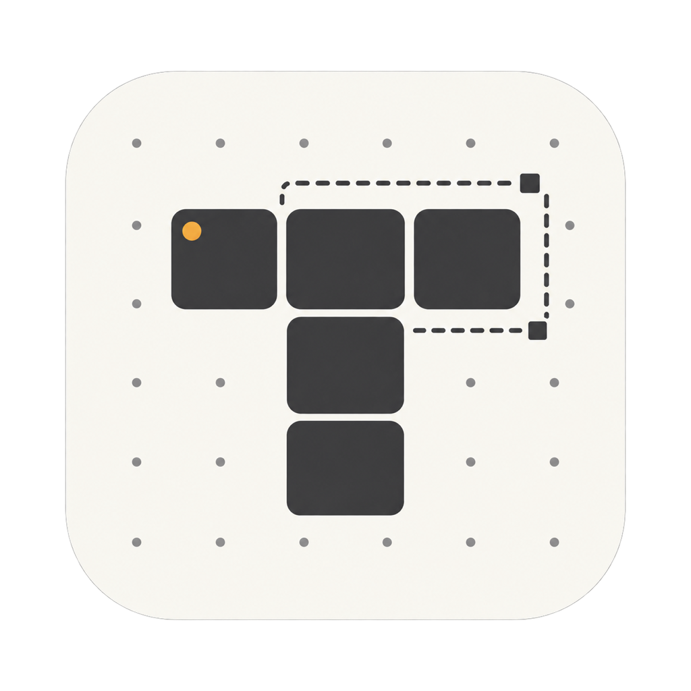
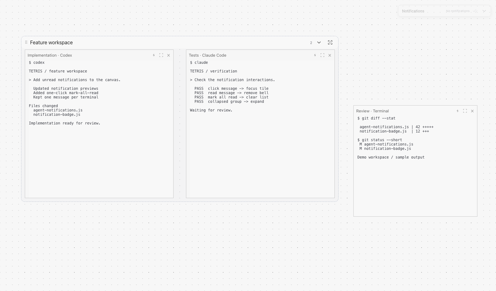
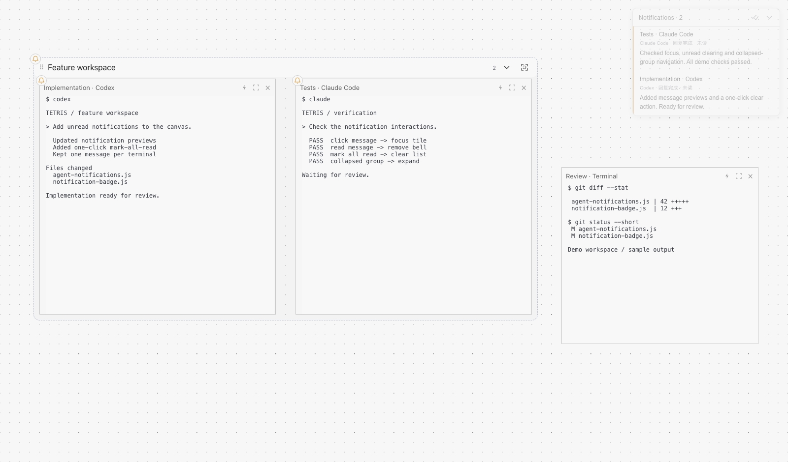
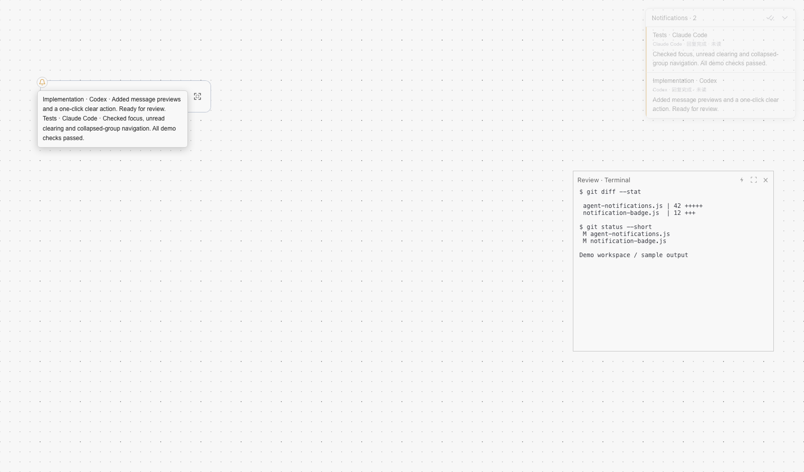
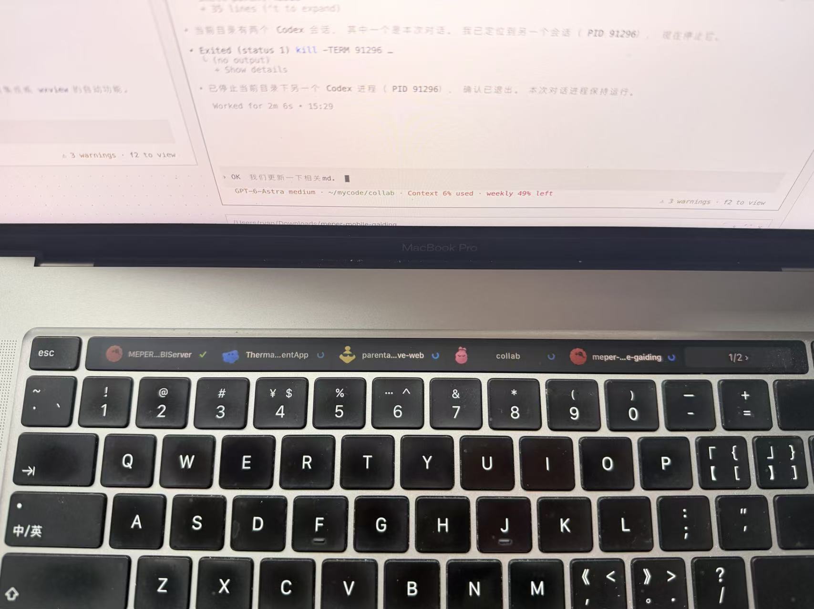
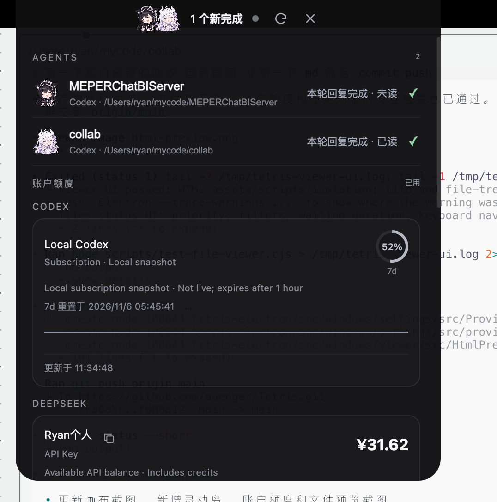

# Tetris

**把终端、Coding Agent 和项目文件放在同一张画布上。**

[English](README.en.md) · [使用说明](docs/guide.zh-CN.md) · [开发指南](docs/development.md)

Tetris 是面向多任务开发的桌面工作空间。每一个 tile 都是一块可移动、可缩放的内容窗口；将相关窗口组成一组，就能像整理积木一样组织任务，暂时收起，再随时展开继续工作。



> 下方画布与提醒截图使用当前真实 UI 组件与演示数据生成，展示画布区域；终端文字不是实际 Agent 的执行记录。复现方法见[截图说明](docs/screenshots/README.md)。

## 主要功能

- **自由画布**：并排摆放终端、文件和浏览器窗口，平移、缩放、调整尺寸，快速定位任务。
- **可折叠分组**：框选多个窗口后命名成组。拖动组标题移动整组，组内窗口仍可独立移动；支持调整组大小、拖入外部窗口，以及在组内新建窗口自动加入。
- **Agent 完成提醒**：Claude Code / Codex 的完成消息带内容预览。同一终端只保留最新提醒，画布右上角集中显示未读消息；点击跳转并自动已读，也可一键全部已读。
- **按需加载文件树**：展开目录时加载，减少打开大型工作目录时的扫描；刷新图标或 F5 可手动刷新当前工作目录的文件树。
- **持久终端会话**：终端由独立 PTY sidecar 托管。正常退出 App 后会话可继续运行，重开后重新连接。

## 提醒与分组



终端或分组左上角显示未读铃铛，悬停查看消息；激活对应终端后铃铛消失。右上角列表支持点击定位、自动清除该条提醒，以及图标按钮一键全部已读。



收起分组只隐藏窗口，不结束其中的终端。点击组名修改名称，拖动标题空白位置移动整组；展开、收起和解组使用图标按钮。

## Touch Bar 与灵动岛

在 **设置 → Agent 状态显示** 中开启 Touch Bar 或灵动岛，设置保存后立即生效。

### Touch Bar：键盘上的任务状态



Touch Bar 显示 Codex 会话的头像、工作目录名称与状态：蓝色旋转标记表示工作中，绿色勾表示完成，黄色标记表示需要关注。点击已关联的会话可定位到 App 内终端；外部会话无法保证跳转，缺少状态证据时显示未知状态。多会话可翻页查看。

### 灵动岛：屏幕顶部的任务总览



无需 Touch Bar 硬件。收起时显示头像和工作中数量，悬停展开会话列表，查看目录、状态、耗时和账户额度；点击会话可定位关联终端。拖动顶部头像与状态区域可调整横向位置，面板保持吸附屏幕顶部并保存位置。

[启用方法与使用边界](docs/guide.zh-CN.md#touch-bar-与灵动岛)。两张配图来自用户提供的实机照片与截图。

## 本地构建

需要 Node.js 22+、Bun，以及当前平台的原生模块编译环境。

```sh
cd tetris-electron
bun install --frozen-lockfile
bun run dev
```

生产构建与未签名打包：

```sh
bun run build
bun run package:unsigned
```

产物位于 `tetris-electron/dist/`，macOS 应用名称为 `Tetris.app`。当前以本地构建为主，未配置 Tetris 发布源，自动更新已关闭。Windows / Linux 有构建目标，但本轮验证以 macOS x64 为准。

## 开始使用

1. 打开 App，添加本地工作目录。
2. 右击画布空白处创建终端，启动已安装的 Claude Code 或 Codex；拖入项目文件可创建文件窗口。
3. 框选相关窗口，输入组名，将一个任务的上下文放在一起。
4. 查看右上角未读提醒，点击消息直接定位对应终端。

[完整操作说明](docs/guide.zh-CN.md)包含分组、提醒、刷新文件树及会话恢复的使用边界。

## 项目结构

```text
tetris-electron/       Electron 应用源码、内部包、构建与打包脚本
docs/                 中英文使用说明、开发说明、功能截图
README.md             中文介绍
README.en.md          English introduction
```

源码内部包使用 `@tetris/*`，画布 CLI 主命令为 `tetris-canvas`。为兼容已有会话与配置，`~/.collaborator`、旧 Electron profile、bundle ID 和 `collab-canvas` 命令别名仍保留；这些是兼容标识。仓库外层检出目录可自行命名。

## 数据与会话

文件、布局和配置保存在本机；项目仍包含 PostHog 匿名使用统计。正常退出 App 与关闭终端窗口不同：**关闭终端 tile 会结束对应会话**。独立 sidecar 不能抵御系统重启或进程被终止；恢复输出是有限缓冲，并非完整历史。App 退出期间不会补存完成提醒。运行中的 Agent 可能引用旧安装包中的 hook，升级时请保留仍被会话使用的安装路径。

## 许可与贡献

Tetris 的自有原创扩展采用 [MIT](LICENSE-EXTENSIONS.md)，署名 `Copyright (c) 2026 auenger`；上游代码及其衍生部分保留 [FSL-1.1-ALv2](LICENSE.md)。完整应用不是纯 MIT 项目。第三方归属见 [NOTICE.md](NOTICE.md)，参与方式见[贡献指南](CONTRIBUTING.md)。

最新功能：HTML / Markdown 预览与源码自动保存、Agent 事件去重、账户额度管理。详见[使用指南](docs/guide.zh-CN.md)与[最新截图](docs/screenshots/README.md)。
