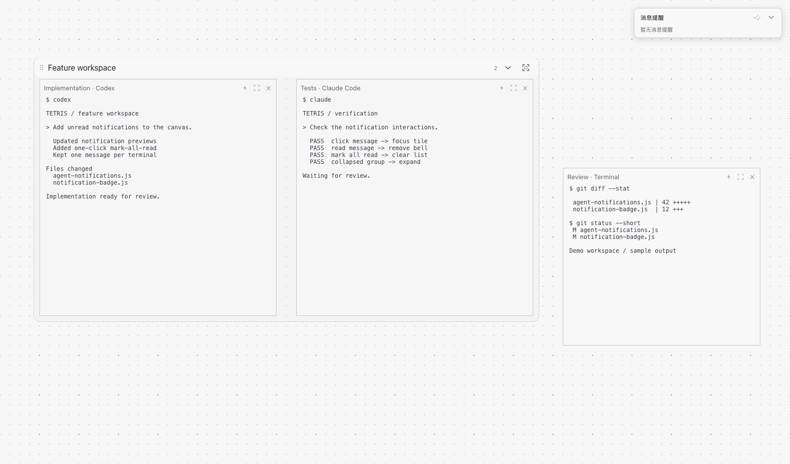
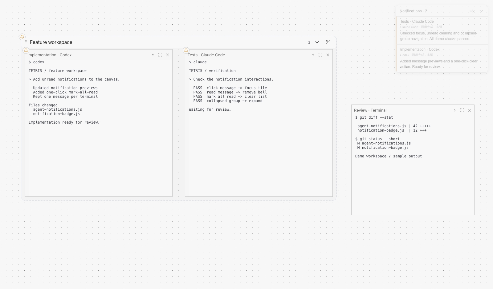

# Tetris user guide

[简体中文](guide.zh-CN.md) · [Home](../README.en.md)

## Workspaces and files

Add a local folder to show its tree in the sidebar. Folder contents load on demand rather than expanding the entire tree at startup. If a file change has not appeared, use the refresh icon above the tree or F5 to reload the active workspace tree. Switching workspaces changes the target of refresh.

Click a file to preview it, or drag it onto the canvas to create a file tile. A tile is a content window: terminal, code, note, image or browser.

## Canvas and groups

Right-click empty canvas space to create a window. Drag its title bar to move it and its edges or corners to resize it. Scroll or Space-drag to pan. Zoom ranges from 25% to 100%; the fullscreen shortcut is configurable in settings.

Select at least two windows with a selection rectangle and enter a name in the selection toolbar to create a group.

| Action | Gesture |
| --- | --- |
| Rename | Click the name label; the rest of the header remains draggable |
| Move a group | Drag the empty portion of its header |
| Move a member | Drag that window's own title bar |
| Resize a group | Drag an edge or corner; the expanded frame must contain its members |
| Collapse / expand | Click the corresponding header icon |
| Ungroup | Click the ungroup icon; member windows remain |
| Add an existing window | Drop an ungrouped window inside an expanded group |
| Create inside a group | Right-click inside an expanded frame and create a window to join automatically |

Collapsing a group does not stop terminal tasks. The collapsed group's bell represents unread member notifications; clicking a message expands and locates the relevant terminal.

## Agent completion notifications

Hooks connect completion events without a separate enable switch. Newly created supported zsh terminals and directly launched agent terminals receive the integration. Terminals opened before an upgrade may retain old environment settings; create a new terminal to pick up new hooks. Install Claude Code / Codex separately.

- A completed turn shows the agent name and available reply preview, with a brief completion fallback when no text is supplied.
- A new notification replaces the previous one for that terminal. The top-right list shows unread messages ordered by time.
- Hover the top-left bell on a terminal or group to read its message.
- Focusing the terminal marks it read and removes its bell.
- Clicking a list item navigates to and activates its tile, then removes the item.
- The double-check icon marks everything read and clears the list. The collapse icon only folds the list.
- When the app is in the background, native notifications may appear subject to system permissions.

Automatic integration is not guaranteed for arbitrary bash, fish or Windows launch paths. Notifications are not retained while the app is closed. Codex integration sets the notify callback for that launch; users with custom callbacks should review their launch configuration. See [implementation notes](../tetris-electron/AGENT_NOTIFICATIONS.md).

## Terminal palettes and image paste

Open Settings → Appearance → Terminal appearance to follow the app or use a fixed light/dark mode. Light palettes include Tetris Light and Paper; dark palettes include Tetris Dark and Midnight. Changes update live terminals without restarting sessions. Explicit agent colors or themes cached at startup may still require an agent-side theme change, such as Claude Code's `/theme`.

Copy a screenshot or image and use the normal paste shortcut (Cmd+V on macOS) to trigger the foreground agent's native image paste. Tetris does not create image files or inject paths/base64; Codex / Claude Code reads the original system clipboard. Native Ctrl+V remains unchanged on macOS. Text uses the standard terminal paste protocol, including bracketed multiline paste.

Image handling requires support from the foreground program. An ordinary shell does not gain image attachments, and an SSH host cannot directly read your local clipboard.

## Session recovery and upgrades

A separate sidecar can keep live terminal sessions running after normal app exit. Reopening the app attempts to reconnect. Closing a terminal tile explicitly terminates its session. System reboot, sidecar termination or session exit prevents continued recovery.

Output replay is bounded to roughly 8 MB rather than a complete log. Building a new app does not itself stop existing sessions, but live agents may reference notification hooks in an older package. Keep that installation path while it is still in use.

Configuration and layout keep using `~/.collaborator` and the previous Electron profile for compatibility. Product labels and the source directory use Tetris.

Screenshots use current components and demo data; see [generation notes](screenshots/README.md).
