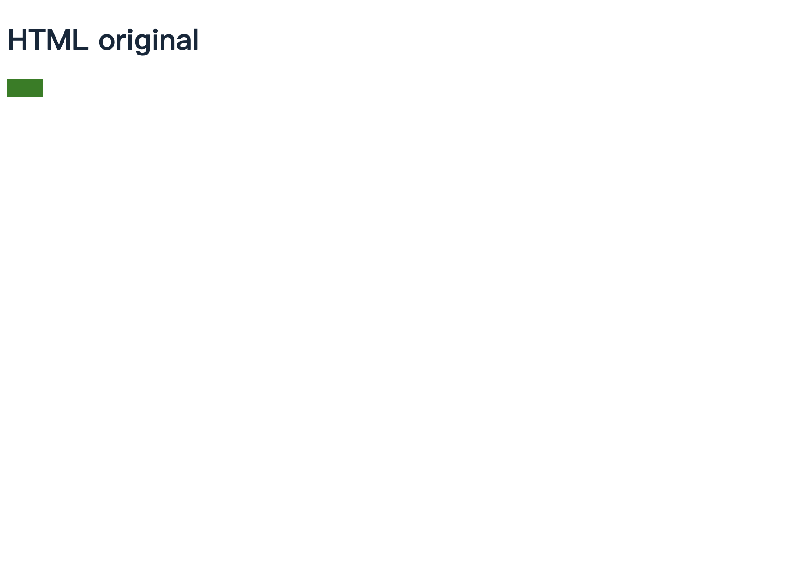
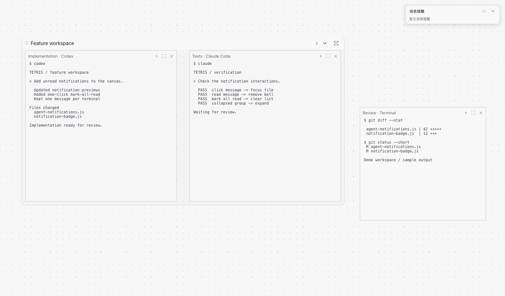
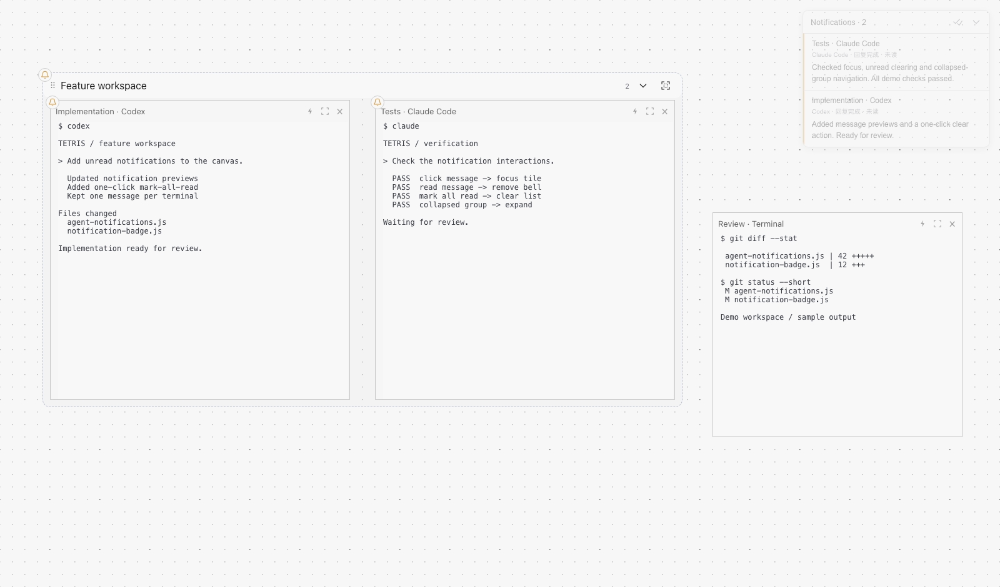
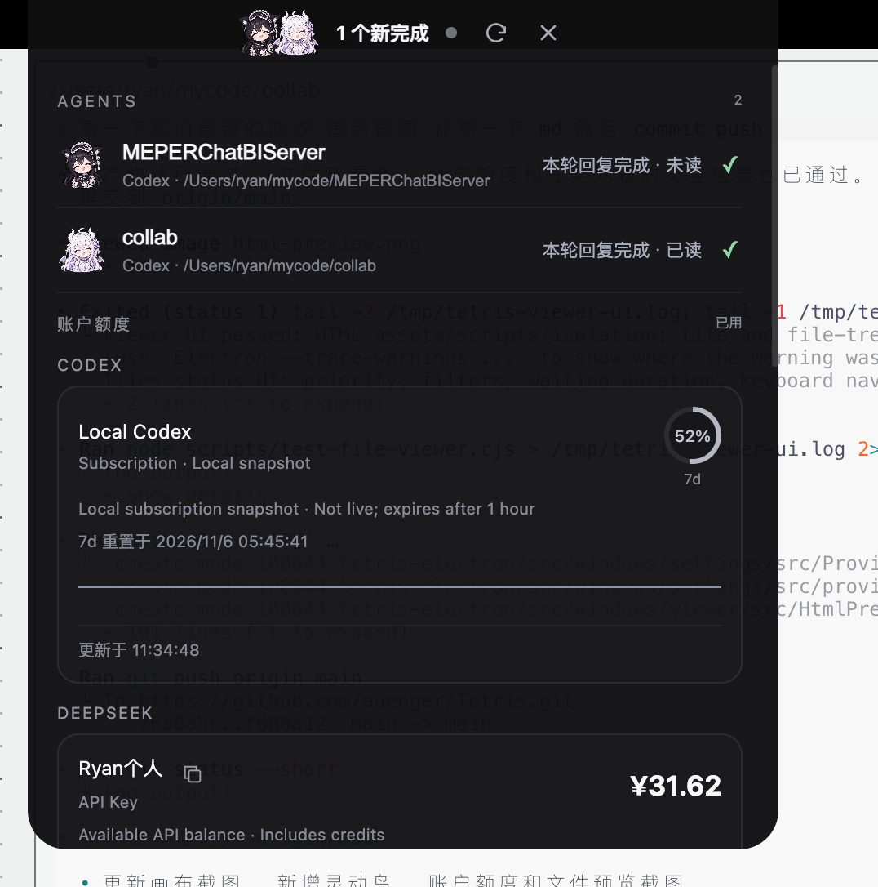
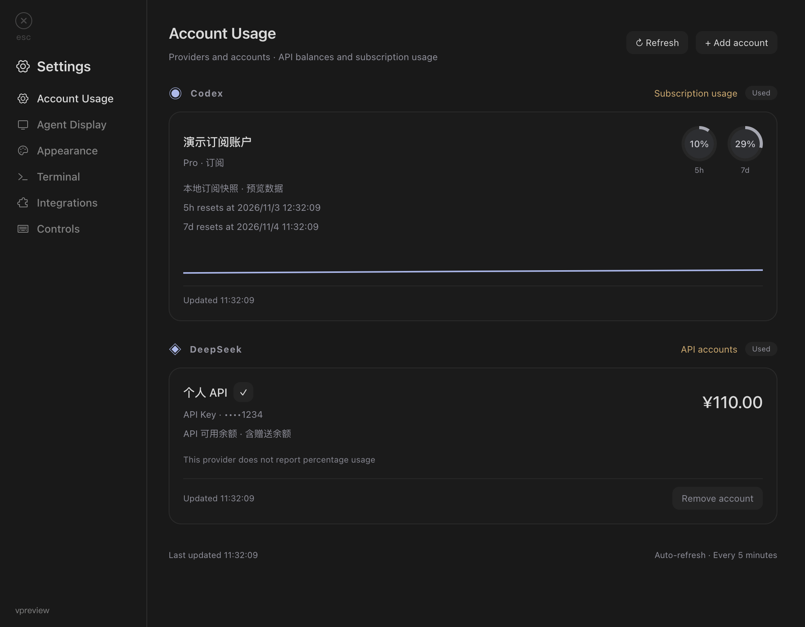

# Tetris 使用说明

[English](guide.en.md) · [返回首页](../README.md)

## 工作目录与文件树

添加本地目录后，左侧文件树展示当前工作目录。目录内容按需加载，不会为了初次展示一次性展开整棵树。展开子目录查看内容；文件变更未及时出现时，点击文件树上方刷新图标或按 F5，重新加载当前工作目录。切换目录后刷新针对新的 active 目录。

点击文件可预览，拖到画布可创建文件 tile。Tile 指画布上的内容窗口，可以是终端、代码、笔记、图片或浏览器。

HTML（`.html`、`.htm`）与 Markdown（`.md`、`.markdown`、`.mdx`）默认展示渲染结果。点击查看器右上角的源码图标进入可编辑源码，再点击眼睛图标返回预览；文件树预览和画布 tile 都支持。源码会自动保存，切回预览时会先等待保存完成。保存失败或检测到磁盘修改冲突时保留源码和提示，解决后再切换。Markdown 源码包含原始 frontmatter；HTML 预览支持相对路径的样式、图片和脚本。

## 画布与分组

右击画布空白处创建窗口。拖动窗口标题栏调整位置，拖动边缘或角落调整大小。滚动、空格拖动可平移画布；缩放范围为 25%–100%，全屏快捷键可在设置中调整。

框选至少两个窗口，通过选择工具栏输入名称创建分组。

| 操作 | 方法 |
| --- | --- |
| 修改组名 | 点击名称 Label，编辑名称；标题其他区域仍用于拖动 |
| 移动整组 | 拖动组标题空白处 |
| 移动组内窗口 | 拖动该窗口自己的标题栏 |
| 调整组大小 | 拖动分组边缘或角落；展开时边框须容纳成员 |
| 收起 / 展开 | 点击组标题对应图标 |
| 解组 | 点击解组图标，成员窗口保留 |
| 加入已有窗口 | 将未分组窗口拖入展开的分组范围 |
| 在组内新建 | 在展开的分组范围内右击创建，自动加入该组 |

收起分组不停止终端任务。收起后组上的铃铛汇总成员未读提醒；点击消息可展开并定位对应终端。

## Agent 完成提醒

提醒通过 Agent hook 接入，不需要单独打开一个“完成提醒”开关。新建的受支持 zsh 终端及直接启动的 Agent 终端会配置接入；升级前已经打开的终端可能仍使用旧环境，需要新建终端才能获得新 hook。Claude Code / Codex 需要自行安装。

- 正常完成一轮时，显示 Agent 名称与可用的回复内容预览；未提供正文时使用简短完成提示。
- 同一终端的新提醒覆盖旧提醒，右上角按时间展示未读消息。
- 鼠标悬停终端或分组左上角铃铛查看内容。
- 激活对应终端后标记已读，铃铛消失。
- 点击列表消息会定位、激活对应 tile，并移除该条提醒。
- 双勾图标将全部消息设为已读并清空列表；列表折叠图标只收起列表。
- 同一任务事件的延迟重发不会重新提醒；新一轮任务即使回复内容相同也会正常提醒。旧版本 Agent 未提供事件标识时，去重以消息内容和新一轮提示词为边界。
- App 在后台时可发送系统通知，显示与否受系统通知权限控制。

目前不能假定任意 bash / fish / Windows 启动方式都自动接入。App 关闭时不补存通知。Codex 接入会在该次启动中设置 notify 回调；已有自定义回调的用户应检查启动配置。协议及排查详见[通知实现说明](../tetris-electron/AGENT_NOTIFICATIONS.md)。

## 灵动岛

在 **设置 → Agent 状态显示** 中开启灵动岛，设置保存后立即生效。

### 灵动岛：屏幕顶部的任务总览

自动读取 macOS 屏幕安全区，左侧显示 28pt 动画头像，右侧常驻显示工作中、空闲、待处理、新完成或未接入。左右区域等宽；黑色背景从屏幕顶部延伸至系统岛底部下方 8pt，避免露出底边，两侧采用内凹曲线和下方圆角，无外框描边。悬停或轻点展开时，面板仍贴住屏幕顶部，连成一体向下延伸；按钮、会话、耗时和账户额度避开摄像头区域。点击会话可定位关联终端。没有刘海的显示器使用可横向拖动并保存位置的顶部浮窗；连接、断开显示器或改变缩放时会重新检测。

六个头像各有空闲眨眼、工作、待处理提醒和完成庆祝四种 GIF 动画，不再使用缩放呼吸效果。相同状态刷新不会重新开始播放；开启系统“减少动态效果”后改用静态头像。“未接入”表示缺少状态证据，不等同于空闲。

当前为贴合屏幕安全区的独立浮层，不是系统原生 Live Activity，也不会同步系统岛的展开动画。原生组件已有预备代码，但尚未在支持的 SDK 和系统上编译验证；当前采用保留正式系统、等待支持版本后再构建验证的路线。Touch Bar 设置及运行逻辑已移除。

灵动岛与 IDE 共用 Agent 会话状态。启用时会安装 Codex 观察 hook；新增 hook 需要在 Codex `/hooks` 中审核，不会自动信任或批准命令。外部终端若没有 App 的路由环境，不会被这些 hook 监控。

账户额度可在 **设置 → 账户额度** 管理。Codex 显示本地日志快照，一小时后失效，并非实时账户查询；圆环表示已用比例。截图中的项目、状态与额度是拍摄时的实机数据，不代表当前账户状态。

## 终端配色与图片粘贴

在 Settings → Appearance → Terminal appearance 中选择跟随 App、固定亮色或固定暗色。亮色提供 Tetris Light / Paper，暗色提供 Tetris Dark / Midnight；配色即时更新，不重启现有终端会话。Agent 显式绘制的背景或启动时缓存的主题仍可能需要在 Agent 内切换，例如 Claude Code 的 `/theme`。

复制系统截图或图片后，在终端使用正常粘贴快捷键（macOS：Cmd+V）即可触发前台 Agent 的原生图片粘贴。App 不创建图片临时文件、不插入图片路径或 Base64；图片保留在系统剪贴板，由 Codex / Claude Code 自行读取。macOS 原有 Ctrl+V 保持直通。普通文本使用终端标准粘贴协议，保留多行粘贴语义。

图片读取取决于前台程序的原生支持；普通 shell 不会因此获得图片附件能力，SSH 远端也不能直接读取本机剪贴板。

## 会话恢复与升级

正常退出 App 后，独立 sidecar 可继续托管仍在运行的终端；重新打开 App 会尝试连接已有会话。关闭终端 tile 会主动结束该会话。系统重启、sidecar 被杀或会话自行退出后不能继续恢复运行。

输出回放仅保留有限缓冲（约 8 MB），不等于完整终端日志。打包新 App 本身不会终止运行中的终端，但运行中 Agent 的 hook 可能指向旧安装包，仍在使用时不要移除该路径。

配置和布局继续使用 `~/.collaborator` 及原 Electron profile，避免改名后丢失现有数据。显示名称和源码目录使用 Tetris。

画布配图使用演示数据；灵动岛配图来自旧版实机。见[截图说明](screenshots/README.md)。

## 账户额度管理

在 **设置 → Account Usage** 中刷新额度、添加服务商账户或删除已保存账户。订阅额度显示各时间窗口的已用百分比和重置时间；支持的 API 账户显示余额。刷新失败会保留最后成功读数，并显示错误与更新时间。

