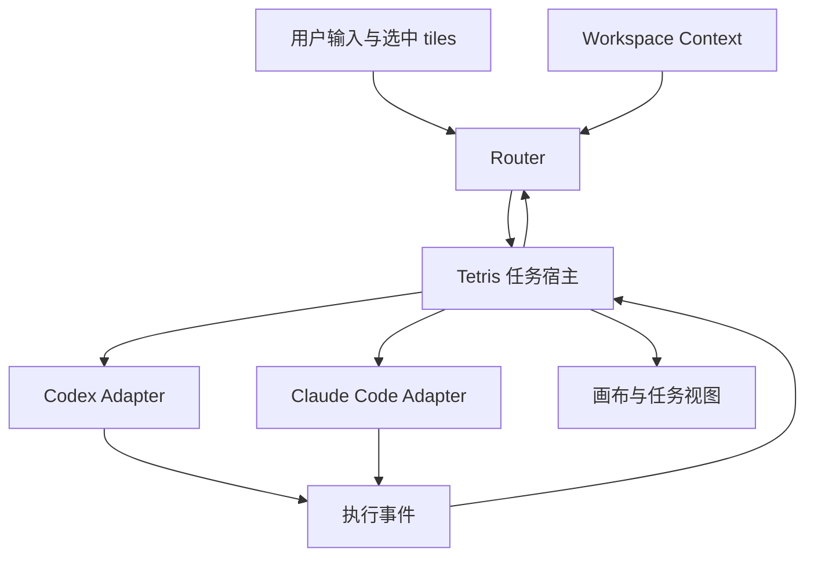

# Tetris Super Agent：研究与实施计划

日期：2026-11-03  
状态：设计草案，尚未实施  
代码基线：`5292f3c`（main）

## 1. 目标与结论

Tetris 可以在现有工作空间与画布能力之上增加 Super Agent：理解用户打开的目录、选中的 tiles 和任务上下文，调度 Codex 或 Claude Code，持续接收补充要求，并把执行状态与产物呈现在画布中。

核心产品价值是让用户能够指着工作现场提出要求，并让系统可靠地推进、跟进和恢复工作。实现重点是任务身份、上下文关联、结构化执行和持久化；动效用于解释真实的派工、交接和交付。

本次是源码阅读与文档研究，没有运行 Lancer，也没有完成 Codex／Claude Code 的端到端接入验证。以下明确区分现有能力、参考资料和建议设计。

## 2. 研究来源

### DSH Super-Agent 编排文章

本地文章：`/Users/ryan/personal-site/src/content/blog/2026-11-03-deepseek-superagent-software-factory.md`

文章强调 Router、宿主任务系统与 Worker 的职责分离：

- Router 判断新请求属于新任务还是已有任务，处理持续到来的补充与跟进。
- 宿主维护任务身份、执行轮次、授权依据、并发槽位和恢复机制。
- Worker 围绕自己的任务执行，内部仍可委派子 Agent。
- 会话完成和业务交付完成不同；任务可以等待回答、评审或验收后继续。

Tetris 应借鉴这一分工。持久化任务应独立于模型上下文和窗口生命周期。

上游参考（本轮主要通过本地文章研究，未逐项重新核验上游实现）：

- https://github.com/deepseek-ai/dsh-superagent-prototype
- https://github.com/deepseek-ai/dsh-superagent-prototype/blob/main/docs/001-domain.md
- https://github.com/deepseek-ai/dsh-superagent-prototype/blob/main/docs/003-execution.md

### Lancer 与 Light UI

已阅读项目 README 和独立 Light UI README：

- https://github.com/raylee-ai/lancer
- https://github.com/raylee-ai/lancer/blob/main/packages/light-ui/README.md

仓库说明中的工作树是任务事件图，节点不必对应 Git 提交。Lancer 将会话、并行分支、运行过程和产物关联展示。

Light UI 是 TypeScript／原生 SVG 的独立模块，无运行时依赖。业务事件发生后，可调用 `createLightLayer().emit(...)`，将源元素与目标节点连接。它提供取消、暂停、清理和缺失锚点处理，支持减少动态效果的系统偏好。模块未发布至 npm，可通过源码打包接入；复用时保留 LICENSE 和 NOTICE。

接入注意：默认覆盖视口；局部容器应避免缩放变换。Tetris 画布有平移和缩放，宜在视口层绘制，通过实际元素位置解析端点。仅在关键事件触发动效，避免每个 token 都发射光线。性能需要在目标机器测量。

用户提到的视频、演示数据及四条泳道的逐项对应关系，本次未独立核验，不作为实现已验证的证据。

## 3. Tetris 当前基础

| 代码或机制 | 已观察到的能力 | 对本方案的价值 |
| --- | --- | --- |
| `tetris-electron/src/main/canvas-rpc.ts` | 列举、创建、移动、聚焦 tile；终端读写 | 画布观察和操作入口 |
| `tetris-electron/src/windows/shell/src/canvas-state.js` | tile 类型、文件路径、终端 cwd、PTY ID 等 | 建立资源关联 |
| `tetris-electron/src/main/acp-agent.ts` | Claude ACP 启动、提示、取消、会话更新 | 结构化执行器起点 |
| `tetris-electron/src/main/agent-session-store.ts` | 共享 Agent 状态与变化事件 | 复用运行状态展示 |
| `tetris-electron/src/main/workspace-config.ts` | 工作目录配置 | 挂接工作空间策略 |
| PTY sidecar 与通知机制 | 终端存活、完成提醒 | 复用基础设施 |

限制：

- 终端读写不等于可靠的任务执行协议，无法单凭文本输入判断交互程序当前状态。
- 已有会话和通知状态不能直接当成持久化任务账本。
- 当前关闭终端 tile 会结束会话，任务与窗口的生命周期需要明确区分。
- 当前 ACP 权限回调会自动选择允许项。多任务调度需要接入明确的任务级权限策略及待确认状态。
- 当前画布 RPC 依赖 renderer。App 关闭后若希望继续编排，核心执行不能依赖窗口在线。

## 4. 产品交互

建议保留 Tetris 自由画布，增加可收起的 Super Agent 对话侧栏。

典型流程：

1. 用户打开工作目录，将需求、代码、预览放入一个 group。
2. 选中该组并输入“根据需求修改登录页，用 Codex 实现，Claude 检查”。
3. 系统确认上下文归属，建立任务与验收条件，创建受管理执行会话及 tile。
4. 实现达到可检查阶段后，将 diff、产物和验收要求交给检查会话。
5. 问题、预览和结果归入同一任务组。
6. 后续“移动端再紧凑一点”归入原任务；有歧义时再澄清归属。

UI 设计：

- 任务与 group 关联，执行、需求、预览、结果均可在组内定位。
- 对话显示当前上下文范围，可明确引用 tile 或目录。
- 派工：消息到执行 tile 的光线；交付：执行 tile 到产物 tile 的光线。
- 任务颜色保持一致；运行、等待回答、失败、待验收使用明确文字。
- 任务树按需展开，不长期挤占画布。
- 缺失、折叠或屏幕外的锚点不伪造连线，可退化为任务状态提示。

## 5. 系统架构

Router 输出任务决策，宿主校验并执行。并发、状态转换、重试与任务恢复由确定性的宿主逻辑维护。

建议模块边界：

- `workspace-context`：聚合目录、选择、tiles 与资源索引。
- `task-store`：保存任务、执行轮次、事件、消息和产物。
- `task-router`：新任务、继续、停止、询问归属等决策。
- `task-scheduler`：并发、依赖、写入冲突与执行恢复。
- `agent-adapters`：统一接入不同执行器。
- `task-events`：将事件投影为 UI 状态和通知。

这些是拟议模块，不代表已存在的实现。

## 6. 上下文感知

先获取轻量索引，再按需读取内容：

- Workspace：稳定 ID、根目录、仓库与分支信息。
- Canvas：当前选择、聚焦、group，以及各 tile 的类型、标题和路径。
- Sessions：执行器、关联任务、可确认的运行状态。
- Recent events：最近派工、提问、交付和失败。

内容读取优先级：用户明确引用 → 选中的 tiles → 当前组 → 当前工作目录。

按需读取文件、项目规则、终端近期输出和执行摘要；浏览器内容读取需要单独实现和验证。不要默认传入所有目录文件或全部终端历史。

画布中可见的已有终端默认可观察；只有用户指定接管或系统新建的受管理会话才可调度。实际文件操作应校验规范化路径和工作范围，读取到的项目内容不应自行扩大任务授权。

## 7. 数据模型与状态

建议持久化实体：

| 实体 | 主要字段 |
| --- | --- |
| Task | id、workspaceId、目标、验收条件、contextTileIds、status |
| Run | id、taskId、provider、sessionId、cwd、状态、起止时间 |
| Artifact | id、taskId、runId、类型、路径或引用、摘要 |
| Event | id、taskId、runId、类型、时间、payload |
| Message | id、taskId、来源、内容、路由与投递状态 |

Task、Tile、Session 分别建模；关闭或删除 tile 不应删除任务历史。重试产生新的 Run，避免覆盖之前失败的证据。

任务状态建议：`queued → running → awaiting_input / blocked / ready_for_review → completed`，另有 `failed / cancelled`。执行轮次另行记录启动、运行和退出状态。

进程退出、模型结束一轮响应和任务完成必须区分。交付包含变更摘要、产物和验证证据；完成依据预先定义的验收条件。

事件使用稳定 ID 去重。恢复时先核对会话是否仍存活，再决定重新连接或标记中断；不得因应用重启自动重复执行外部副作用。持久化方案需结合现有存储评估，优先考虑事务支持的本地任务存储。

## 8. 执行器接入

统一能力接口：`start / resume / send / interrupt / subscribeEvents / getCapabilities`。

统一事件：开始、进度、需要输入、权限请求、产物、轮次结束、失败。各适配器保留真实能力差异，不模拟不支持的恢复或中断。

第一条路径优先复用现有 Claude ACP。Codex 的结构化接口和本机版本需在实施前核验，不能直接假设任意 CLI 都支持同一种协议。

终端写入仅作为辅助操作入口。已有任意终端的完整接管不列入第一版。受管理会话可以使用专门的执行视图展示结构化消息与日志，不必假设结构化执行可以无缝嵌入现有交互 TUI。

## 9. 并发与运行边界

- 第一版同一工作目录默认只运行一个写入任务。
- 并发写入任务优先使用独立 Git worktree，最终集成明确安排顺序。
- worktree 不提供操作系统级隔离，也不自动解决需求或合并冲突。
- 用户补充消息通过受控投递队列送到对应会话，避免忙碌期间重复提交。
- 中断任务时更新宿主状态并确认执行器停止，保留已有产物。
- 初版保证任务记录可恢复；App 退出后持续调度作为后续能力，不与现有 PTY 存活能力混淆。

## 10. 分阶段实施与验收

### 阶段一：感知与任务基础

实现 Workspace Context、Task/Run 存储和上下文范围展示。

验收：多个目录和 group 下能准确识别选中资源；路径重命名或 tile 删除后关联可解释；重启后任务记录仍在。

### 阶段二：单执行器完整闭环

接入 Claude ACP，支持创建任务、执行、补充输入、中断、交付与失败记录；创建关联执行 tile 或视图。

验收：真实任务产生文件变更和验证结果；补充信息进入原任务；失败可追溯；重启不会重复派工；权限请求能进入明确处理流程。

### 阶段三：Codex 与有限并发

核验并接入 Codex 结构化接口，增加执行器选择、依赖任务、并发限制与 worktree 策略。

验收：两个执行器均有真实运行测试；串行交接携带产物与检查要求；冲突、取消、异常退出均保留准确状态。

### 阶段四：任务可视化与动效

加入任务总览、任务组状态、关键事件连线；评估复用 Light UI。

验收：平移缩放、组折叠、目标移除和窗口尺寸变化时定位正确；事件重复不重复发射；减少动画模式正常；动效失败不影响任务状态。

### 首版明确范围

选中一组 tiles → 输入目标 → 创建一个受管理会话 → 查看过程 → 回答提问／补充要求 → 查看产物 → 重开 App 找回任务。

首版不包含：任意终端自动接管、跨仓库无限并发、自动合并所有变更、无人值守发布或完整软件工厂 SOP。

## 11. 实施前仍需核验

1. 当前 ACP UI 与会话恢复链路的实际覆盖程度。
2. 本机 Codex／Claude Code 版本、结构化协议及认证方式。
3. 画布分组与 workspace 的稳定 ID、持久化和事件入口。
4. 现有 session 状态在异常退出后的可靠性。
5. 任务存储与 sidecar 的职责边界。
6. Light UI 在 Tetris 实际缩放画布中的定位和性能。

建议先完成阶段一、二，用真实任务验证闭环，再增加跨执行器并发和视觉效果。

## 12. 首轮开发进度

开发分支：`feat/super-agent`。

已开始实现画布元数据与选择快照、Claude 提示上下文注入、单会话任务及执行轮次持久化、异常重启后的 interrupted 标记、面板状态展示，以及不同会话事件过滤。当前会话内的后续消息归入同一任务，尚无自动任务拆分或 Router。

尚未实现：独立任务选择与恢复 UI、Codex 适配、任务级授权交互、多执行器调度、worktree 管理和 Light UI。现有 Claude 权限机制仍需替换为完整任务级策略；本轮仅避免无 allow_once 时误选其他权限项。

验证：任务存储与画布相关 10 项测试通过。全量 TypeScript 检查存在项目级错误（包括编辑器类型、聊天运行时类型、bun:test 类型声明及项目 include 配置）；真实模型和 Electron UI 闭环尚未验证。

### 第二轮：执行器与任务入口

已实现 Codex JSONL 执行适配器（使用本机 CLI），指定 thread ID 续接、中断及失败反馈；入口支持选择 Claude／Codex、查看同目录任务并继续指定会话。Claude 恢复改为明确指定任务且等待恢复完成，避免使用全局最近会话。任务记录保存助手文本，续接时从执行记录恢复对话，并提供人工验收入口。

验证：11 项定向测试通过，包含真实子进程的模拟 CLI 协议测试（事件、指定线程恢复、失败）；该测试不是实际 Codex 模型调用。核心新增模块未在当前类型检查中报告生产代码错误，但全项目类型检查仍有其他错误。实际模型运行与界面操作尚待验证。

后续仍需推进：权限请求 UI、上下文范围与任务组绑定、排队与依赖交接、worktree 并发、产物与任务树、关键事件动效，以及真实执行验收。不能将当前单会话执行入口视为完整 Super Agent Router。

Codex 参考：https://learn.chatgpt.com/docs/non-interactive-mode ，并核对本机 `codex exec --help` 与 `codex exec resume --help`。

### 第三轮：授权与手动交接

Claude ACP 权限请求改为等待面板中的单次授权／拒绝，取消、退出和轮次结束会清理待处理请求。通过 ACP `setSessionMode(default)` 设置权限模式（本地包从 settings 读取默认值，不能只依赖环境变量）。Codex exec 仍使用 workspace-write；该 CLI 路径尚不提供相同的交互授权能力。

工作目录通过 realpath 规范化；同目录第二个执行请求暂时明确拒绝，尚未实现自动排队。执行前取消不再继续派工，关闭会话或 App 会记录取消／中断。

新增“交给另一执行器检查”：创建另一个执行器的会话，保存来源任务关联，预填原始要求、最新要求与上一轮报告供用户发送。此处是明确的人工交接入口，尚不是自动依赖调度。删除旧全局会话偏好与全局消息缓存逻辑，避免不同任务串用历史。

验证：权限请求归属、无效选择、取消清理等单项协议测试通过；任务存储和 Codex 子进程协议回归通过。本轮新增生产模块未出现类型检查诊断；全项目类型错误、真实权限弹窗及模型执行仍待最终核验。

### 第四轮：排队与独立 worktree

加入两槽位调度器：同一规范化执行目录串行，不同目录可并行，等待中的轮次保存 queued 状态；取消、关闭与重启不会自动重放排队工作。任务仍可在 App 存活期间自动获得空闲槽位。

新任务可选择独立 worktree，创建 `tetris/task-<uuid>` 分支并保存来源目录、实际执行目录和分支。当前源仓库必须干净，避免遗漏未提交改动。启动失败会保留并报告已创建 worktree 的位置，不自动删除用户可能需要检查的文件。尚未实现最终集成或 worktree 清理入口。

界面保留后台会话组件，返回任务列表可继续创建任务；历史任务按来源工作空间归类。提示上下文明确要求在独立 worktree 内执行。该机制不构成操作系统安全隔离。

验证：临时 Git 仓库实际创建 worktree/分支与脏目录拒绝通过；调度器同目录串行、跨目录并发及排队取消通过。测试发现 macOS `/var` 和 `/private/var` 路径差异，已通过 realpath 规范化修复。

下一步：自动依赖交接与工作空间 Router、上下文范围展示和任务组绑定、产物与任务图、关键事件动效、真实界面及 Agent 执行验证。

### 第五轮：上下文与产物连接画布

画布快照包含选择、聚焦 tile 和分组。上下文采用选择优先，扩展同组成员；否则使用聚焦对象／所属组，再回退当前目录内的资源。输出只含引用元数据，不包含终端输出；面板可刷新查看范围。执行轮次保存实际使用的快照，可定位关联 tiles。

执行器文本报告保存到应用数据目录 `task-artifacts/<runId>.md`，面板提供打开报告入口。报告 tile 尝试加入原分组，或与未分组的上下文 tiles 建组；跨多个已有组时不自动合并用户分组。执行报告明确标注需结合实际变更验收，不能替代代码 diff 或验证结果。

验证：上下文选择/分组扩展与目录边界测试，加现有画布 RPC、分组回归共 14 项通过。新增上下文模块和面板未出现本轮类型检查诊断；整体项目检查仍有其他错误。画布视觉与真实模型闭环仍需验证。

### 第六轮：自动检查与任务总览

会话可配置“完成后交给另一执行器检查”。宿主仅在正常结束且未取消时触发一次交接，传入来源任务要求、报告与原上下文；释放原执行槽位后启动检查会话，不给检查会话默认开启递归交接。每轮保存交接目标、starting/started/failed 状态；重启遇到未确认的 starting 会标记失败而不重放。

总览持续更新任务状态，使用父任务关联显示检查任务，并提供报告及停止入口。自动启动的会话使用后台监视视图，支持输出查看、权限请求和结束后进入对话。仍需真实运行验证自动交接边界。

尚待完成：自然语言 Router、关键事件动效、最终集成与 worktree 管理入口、实际 UI 与模型端到端验证。当前总览为可操作的任务关系列表，尚不能声称完整任务事件图已实现。

### 第七轮：自然语言 Router 与持续跟进

工作空间入口支持自然语言安排工作。Router 使用本机 Codex 的 read-only、ephemeral 模式，仅接收任务标题/状态及画布引用索引，返回 create/continue/stop/clarify 决策；宿主验证动作和当前工作空间内的任务 ID 后执行。执行器仍可选 Claude 或 Codex，不确定的归属返回澄清，不猜测目标。路由超时会取消并提示使用直接执行入口。

运行中的已有任务收到补充要求时，宿主先持久化队列，当前轮结束后继续；停止任务会清理待处理要求。检查交接延后至补充工作处理完毕。任务总览显示待处理数量。当前路由依赖本机 Codex 登录，尚无 Claude 路由后端。

验证：动作/任务 ID 校验及任务存储测试通过。上一轮完整生产构建成功（2 分 22 秒）；该构建不包含本轮新增 Router，最终需对全部代码再构建。实际模型路由、动效、界面端到端和 worktree 最终集成仍未完成。

### 第八轮：事件动效与首次界面检查

新增无运行时依赖的原生 SVG 动效层，使用视口坐标实时计算曲线路径。真实 running 事件从 Agent 面板边缘向关联 tiles 发射光点，关联 tile 显示流动虚线边框；执行结束清理边框，报告在画布打开后触发 delivery 动效。目标隐藏、删除、离开视口或系统减少动画设置时跳过/取消光线，空闲无动画帧循环。当前源锚点是 Agent 面板，不是跨 webview 的具体聊天气泡；没有宣称逐气泡对齐。

使用 ego-browser 检查开发服务器的真实 React 界面与模拟接口：任务入口、执行器选择、聊天发送及模拟响应可用。动态导入实际动效模块验证边框创建、目标删除和清理，结果为 borderCreated=true、remainingBorders=0。截图位于 `/tmp/tetris-super-agent-ui.png`。浏览器模拟执行不能替代真实模型与 Electron IPC 验证。

继续使用浏览器 TaskSpace 13（Tetris Super Agent verification），预览服务 `http://127.0.0.1:5199/agent-chat/index.html`；不要另建重复验证空间。

### 第九轮：worktree 集成与真实执行探测

增加独立目录变更查看、已提交变更快进集成，以及已集成干净目录清理。集成仅使用 `merge --ff-only`；源目录和任务目录必须干净。清理确认任务提交是源分支祖先，且目录位于 Tetris 管理的存储中；保留分支和任务历史，关联任务标记 archived。临时 Git 仓库的实际创建、提交、集成、清理测试通过。

真实执行探测：本机 Codex 0.166.0、Claude Code 2.1.312，Codex 登录状态为 ChatGPT 已登录。通过实际 CodexExecutor 发出无工具、无文件修改的最小响应请求，45 秒内未收到响应，测试主动取消；因此不能判定真实执行通过。Claude ACP 也进行了最小握手与响应探测，需继续定位其等待阶段。未修改用户认证配置，也未将超时误记为成功。

### 第十轮：真实链路诊断

将探测分为初始化、建会话、设置权限模式和 prompt。Claude ACP 前三阶段均通过，等待发生于模型响应；120 秒后探测主动关闭，尚未取得成功响应。Codex 真实调用在较长等待及重试事件之后返回 `TETRIS_EXECUTOR_OK`，stopReason=end_turn，证明当前本机执行适配器可获得真实响应。Router 总等待上限由 60 秒调整为 120 秒。

修复聊天运行时的工具参数 JSON 类型、文本部分类型收窄、可空工具调用结果等类型问题；本轮 Web 类型检查中不再出现 agent-chat 目录错误。项目其他组件仍存在类型检查错误，不扩大到无关修复。

### 第十一轮：集中回归与 Electron IPC 验证

关键模块集中回归 8 项通过，生产构建成功（2 分 17 秒）。随后补充 Claude 启动错误清理与初始化超时保护，需在最终交付检查中覆盖该最后改动。新增使用说明 `super-agent-usage.md`。

Claude auth status 确认 loggedIn=true、oauth_token、firstParty。独立 Electron 窗口使用临时 userData，真实注册应用 Agent IPC 和画布 RPC；画布响应采用明确测试夹具，实际启动 Codex 并等待执行、持久化及报告结果。当前验证进程句柄为 17632，未结束前不得重复启动。浏览器预览进程 31341 与 TaskSpace 13 保留用于后续检查。

Electron IPC 探测已完成：status=ready_for_review、output=TETRIS_IPC_OK、contextTileCount=1、reportSaved=true。证明独立 Electron renderer → 真实应用 IPC → Codex → 持久化任务/报告链路通过；画布快照为测试夹具，不能据此代替完整主窗口视觉验收。进程 17632 已正常退出。

### 第十二轮：真实主窗口接入修正

检查主窗口发现旧聊天入口硬编码 `~/.collaborator` 且默认走终端。现已让未显式关闭 GUI 的配置默认打开 Super Agent，并使用已打开工作目录；任务首页增加工作目录选择器，后台聊天保留创建时的目录，不随首页切换串用工作空间。

目录列表与当前目录统一 realpath，修复 macOS `/var` 与 `/private/var` 导致历史任务过滤不匹配的问题；上下文回退筛选也规范化现存资源路径。

独立开发主窗口已启动，日志确认加载 agent-chat；通过其真实画布 RPC 创建并列举临时 README note tile，成功返回正确路径。原生 Computer Use 服务返回 native pipe startup failed，无法完成该主窗口的视觉操作验收；没有将 RPC 成功等同于视觉验收完成。开发进程 3794、Claude 长时探测 6009 尚需收取结果/清理。

### 第十三轮：收口与明确阻塞

Claude 长时真实探测已返回终态：ACP initialize、newSession、setSessionMode 均成功，prompt 返回 `API Error: Unable to connect to API (ECONNREFUSED)`。这说明当前环境无法连接其模型 API；不能把认证成功当成模型执行成功，也不修改用户认证或代理配置来绕过该问题。

最后代码检查修正两处边界：Router／交接提供的上下文只覆盖首轮，后续发送重新读取画布；worktree 快进集成同时检查来源目录是否有受管理任务执行。

当前功能与验收状态：

| 范围 | 实现 | 验证状态 |
| --- | --- | --- |
| 工作目录与 tiles 感知 | 目录选择、realpath、选择/分组/聚焦、引用预览 | 定向测试、真实画布 RPC 通过 |
| 任务记录 | Task/Run、排队、报告、恢复、中断、人工验收 | 持久化和协议测试通过 |
| Codex 执行 | CLI JSONL、恢复、取消、失败事件 | 真实模型与 Electron IPC 报告链路通过 |
| Claude 执行 | ACP、会话恢复、单次授权、取消、启动清理 | 握手通过；模型 API 连接被拒绝，完整执行待验 |
| 路由与协作 | 新建/跟进/停止/澄清、补充队列、人工及自动检查交接 | 决策校验和调度测试通过；跨执行器实测受 Claude 阻塞 |
| 独立工作目录 | worktree、两槽位、同目录串行、diff、快进集成和清理 | 临时 Git 仓库实际测试通过 |
| 可视化 | 任务父子关系、报告加入画布组、运行边框、交付光线 | 浏览器模拟与 SVG 生命周期通过；原生主窗口视觉验收待验 |

原生 UI 自动化服务不可用，返回 `native pipe startup failed`。完整主窗口点击、权限处理、平移缩放与自动交接不能标为已验收。当前仍有外部环境阻塞，整体目标不标记完成。后续恢复时先验证 Claude API 可达和原生自动化可用，再沿现有链路验收，不重复开发已实现模块。

### 第十四轮：代理修复后双执行器真实文件闭环通过

用户配置 Claude 代理后重新验证，实际 ACP prompt 返回 `TETRIS_ACP_OK`，stopReason=end_turn。随后使用独立 Electron renderer 调用真实 Agent IPC，在临时 Git 仓库创建 `proof.txt`，通过宿主单次授权接口响应请求，再由执行器读回。宿主最终读取磁盘文件，内容精确为 `TETRIS_CLAUDE_FILE_OK\n`；任务状态 ready_for_review，报告已保存。授权操作由测试夹具调用真实接口，不等同于原生按钮点击验收。

同样的 Codex 文件任务通过，磁盘内容精确为 `TETRIS_FILE_OK\n`，任务及报告均正常。两次测试只写各自临时目录。

完整生产构建通过（4 分 27 秒）；最后两处主进程边界改动另行生产构建通过（3.44 秒）。关键模块 8 项测试、30 个断言通过；全局 TypeScript 检查仍有原有组件及 bun:test 类型配置错误，本次修改的生产模块和 agent-chat 没有诊断。

本轮解除 Claude API 阻塞。当前待完成的是自动跨执行器交接的真实验收，以及原生主窗口视觉操作验收；原生服务复查仍返回 native pipe startup failed。保留现有浏览器验证空间，后续不重新开发已完成模块。

### 第十五轮：事件去重补齐与交接验收

对照动效验收项，发现旧实现只在飞行期间去重，飞行结束后的同 ID 重投会再次播放。新增最多保留 256 个事件 ID 的缓存，避免重复事件重新激活光线及运行边框；销毁时清空。真实浏览器载入该模块验证：首次 running 创建边框，finished 清理后重投相同 running ID 被忽略，结果 first=true、duplicateIgnored=true。

自动 Codex→Claude 真实交接已通过：父任务创建 `proof.txt` 后进入 ready_for_review，handoff=started，Claude 子任务具有正确 parentTaskId，读取实际文件并执行字节级核验，子任务也进入 ready_for_review 且报告存在。宿主再次读磁盘，内容精确为 `TETRIS_HANDOFF_OK\n`。两执行器实际运行且交接由宿主自动触发，非模拟输出。

独立自然语言 Router 实测在 120 秒后超时，宿主取消并报“任务路由超时，请重试或直接选择执行器”。取消出口通过，但不能据此声称真实路由决策通过。当前本机模型配置为 gpt-6-astra、medium；不擅自改用户配置。后续需要进一步确认请求延迟来源或验证 Router 在该环境下的可用性。

本轮生产修改仅为独立 SVG 模块的有界事件去重，已通过浏览器实测、Node 语法检查及 diff 检查，未重复执行全项目构建。原生主窗口验收仍受原生自动化服务不可用阻塞。

### 第十六轮：Router 超时定位与验收阻塞

实际 Codex read-only/ephemeral 请求在 1.7 秒内启动 thread，在约 48、63、79、96 秒报告 `Reconnecting... (request timed out)`。随后第 117 秒收到 turn.completed，但 CLI 未退出，第 120 秒的取消错误覆盖了完成结果。连接延迟之外，还定位到执行器的终态判定问题。

Router 现识别连接类错误事件，超时时明确显示“Codex 连接模型时发生超时或重连，任务尚未派发”，同时保留直接执行入口。定向解析测试 1 项通过、主进程生产构建通过（2.52 秒）。

进一步修正 CodexExecutor：已经收到 turn.completed 且没有 turn.failed 时，CLI 退出期间发生取消不再覆盖为 cancelled。增加真实夹具子进程测试，模拟发出完成事件后保持进程存活，再取消退出，验证返回 end_turn。宿主的用户取消状态仍独立生效，不因此自动继续派工。

原生自动化再次返回 `Sky Computer Use native pipe startup failed`，已连续多个工作轮次无法执行真实主窗口交互。完整验收还需要：

1. Codex 路由请求能够在超时范围内取得实际决定，验证新建／跟进的真实派发。
2. 恢复原生 UI 自动化服务，或取得用户对实际主窗口操作的验收证据，覆盖上下文选择、权限按钮、任务/报告定位和动效随画布变化。

当前代码与交接链路已有真实证据，但上述条件仍缺失，不能把整体目标标记完成。

修复后定向回归 2 项、10 个断言通过，主进程生产构建通过。再次调用实际 routeTask 仍在连接重试后超时，新的“连接模型时发生超时或重连，任务尚未派发”提示正确触发；未取得成功派发证据。至此停止重复请求，等待 Codex 网络和原生自动化服务恢复后继续完整验收。
