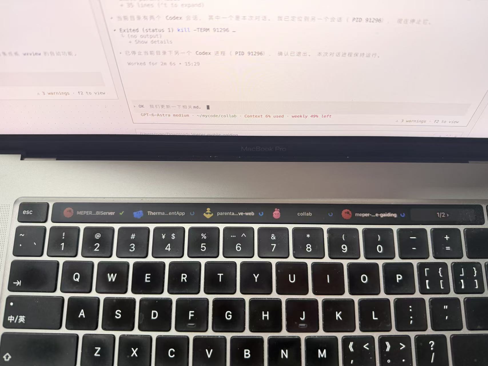

# Codex Touch Bar (macOS)

Current user instructions and real-device images: [Touch Bar and Dynamic Island](../docs/guide.en.md#touch-bar-and-dynamic-island). The sections below record implementation evolution; the later settings section supersedes the old View menu controls. Dynamic Island v2 now uses an independent Electron window and event state; see its [current implementation notes](resources/dynamic-island/README.md).

The main window installs a native Electron Touch Bar automatically. Every two seconds it discovers the current user's native Codex CLI processes, excludes app-bundled services and app-server/mcp-server processes, and associates process ancestry with existing PTY sessions.

- `Codex × N`: detected CLI process count (not thread/subagent count).
- Status button: terminal label or external PID, and `运行中`.
- A received Codex completion notification briefly shows `本轮完成` for ten seconds.
- Tap the status button to navigate to an associated in-app terminal. External terminals cannot be opened this way.
- `切换 ›`: cycle through discovered CLI processes.

The Touch Bar follows the app window; it is not globally visible when another app is active. Other platforms are unaffected. No global Codex configuration is modified. Existing external CLI processes are countable without hooks, but their internal state is unknown. Thinking, tool activity, approval, and idle states require additional lifecycle integration and are not inferred from process existence. Completion events use the existing per-terminal notification integration. A machine with Touch Bar hardware (or a simulator) is required to validate rendering and touch interaction.

## Experimental built-in resident mode

On macOS, use **View → Touch Bar 跨 App 常驻（实验性）**. The option is off by default and persisted. An embedded, windowless AppKit helper adds a compact `Codex N` button to the system Control Strip; a checkmark briefly marks completion. Click it to return to Tetris and the selected terminal. The existing full window Touch Bar still provides session cycling.

This uses dynamically resolved private `DFRFoundation` / `NSTouchBarItem` interfaces. Unsupported interfaces or startup failures disable the option with an error. Control Strip visibility depends on macOS Touch Bar settings (a hidden Control Strip or function-key mode can hide it). This is a prototype, not a guarantee of visibility across all macOS releases. No BTT, Pock, global Codex configuration changes, or login item is required. Closing the stdin pipe removes the item; quitting Tetris stops the helper.

For development, run `npm run build:touchbar` once before starting the app. `npm run build` and npm packaging lifecycle hooks also build the universal arm64/x86_64 helper. The generated `.app` is ignored by git and included only in macOS package resources. Build hosts need Xcode Command Line Tools; users of a packaged app do not. Distribution signing/notarization and physical Touch Bar interaction still require validation.

## Tiled layout and full-width option

**View → Touch Bar 占满整条（隐藏系统按钮）** opts into a native system-modal layout (`placement: 1`). It requests all available width with equally sized two-line session tiles and a close button. Five sessions fit per page in this layout; the next-page button appears only when needed. The ordinary window layout shows up to four sessions per page. Enable resident mode as well to retain full-width display across app switches; otherwise it dismisses when Tetris loses focus. The close button temporarily dismisses the full bar; the Codex Control Strip button reopens it.

Labels now prefer each Codex process's actual working directory (`lsof cwd`), with the known PTY directory as fallback. Paths truncate from the start. `working` is a best-effort observation of the last eight captured terminal lines containing Codex's `esc to interrupt` footer, not an authoritative lifecycle event. `done` is a recent completion notification. External sessions without captured terminal state show `状态未接入`. Terminal captures are inspected in memory and not persisted by this feature. Native full-width layout still needs physical-device verification across OS versions.

## Single-line styling and weekly balance

Full-width tiles keep directory and state on one line: blue for working, green for done, amber for attention, neutral for unknown. The trailing fixed-width area contains `Weekly ≈N%` and the close button in that order. Weekly is a local usage snapshot, not a live account query: the reader checks up to eight recent JSONL session tails under CODEX_HOME, recognizes a 10080-minute window in either primary or secondary, and rejects snapshots older than one hour or past reset. It refreshes at most once per minute and shows `Weekly —` without usable evidence. This is the default Codex home's most recent snapshot, not an aggregation or per-terminal account attribution. Dot avatar artwork is pending confirmation; Codex pet assets are not included.

## Dot session icons

The two user-supplied avatar sheets are bundled unchanged under `native/touchbar/assets`. Rendering selects eight distinct portraits from source rectangles; no Codex pet assets are used. A PID receives one random portrait until it disappears from discovery. Labels show only the working-directory basename. Full-width tiles draw the avatar, left-aligned basename, and a blue rotating working arc / green check / amber attention mark / neutral unknown dot. The ordinary Electron bar uses the same portraits with static status glyphs. Animation redraws only visible working tiles while the full-width bar is presented. The right-side Weekly balance and close control remain separate fixed-width items.

## In-app settings and Dynamic Island

Settings → Agent 状态显示 now owns the Touch Bar enable, full-width, resident, and Dynamic Island toggles. Changes persist and apply immediately; the old View menu toggles are removed. Dynamic Island is an independently enabled native, nonactivating floating panel on the primary screen below its menu/notch safe region. It supports the same avatars, status indicators, three sessions per page, and terminal navigation without Touch Bar hardware. This first version is a compact floating status strip, not a hardware-notch morphing implementation. Display positioning is refreshed with status updates.

Research references: https://github.com/TheBoredTeam/boring.notch (GPL-3.0), https://github.com/prodBirdy/openNook (MIT). No source from either project was incorporated; the existing AppKit helper implements the Codex-only panel.

Completion/attention notifications now take priority over stale terminal interrupt footers. A footer must disappear before representing a new working turn after completion. Unchanging working evidence becomes unknown after 30 seconds without a completion event, rather than falsely claiming done. Since terminal text is still a fallback, a new turn occurring entirely between polling intervals may not be detected until its footer clears. Both displays consume the same resolved state. Full lifecycle hooks remain a future improvement.
