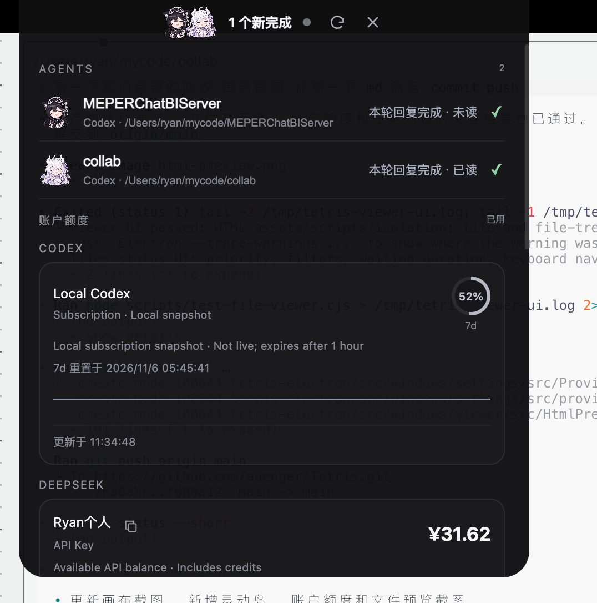

# Notch-aware Dynamic Island

Historical user-provided capture of the previous floating layout; it does not show the current silhouette. Values reflect capture time. See the [user guide](../../../docs/guide.en.md#dynamic-island) for setup and interaction.

The Electron controller (`src/main/dynamic-island.ts`) reads a small universal macOS helper (`native/display-geometry/main.m`). The helper uses public `NSScreen.safeAreaInsets` and `auxiliaryTopLeftArea` / `auxiliaryTopRightArea`, returning the display ID and camera housing geometry in logical points. It runs only at enable and display changes. `island-position.ts` selects a detected notched display and keeps a compact avatar-and-status window beside the camera region and expands into a 400pt-wide panel anchored to the same display top, with controls below the safe area; otherwise the saved draggable floating panel is used. No CPU/model lookup or menu-bar height heuristic is used. Detection failure logs a warning and falls back to the floating panel.

Implementation references: [Apple safe-area API](https://developer.apple.com/documentation/appkit/nsscreen/safeareainsets) and [Boring Notch window architecture](https://github.com/TheBoredTeam/boring.notch/blob/main/boringNotch/components/Notch/BoringNotchWindow.swift). The AppKit helper and Electron integration are independently implemented; no third-party source is bundled. This implementation remains an independent overlay, not an ActivityKit widget extension. Apple now documents native Mac Live Activities and Dynamic Island in [Bring Live Activities to Mac](https://developer.apple.com/videos/play/tech-talks/111467/); the new PROLED Macs must not be treated as the older wide-notch hardware. Compact/expanded presentation was also studied in [DynamicNotchKit](https://github.com/MrKai77/DynamicNotchKit).

`bun run dev`, `bun run build`, and packaging build the arm64/x86_64 helper automatically on macOS (Xcode command-line tools required). Touch Bar settings, runtime and native helper have been removed. Existing saved Touch Bar preferences have no effect. Agent events, terminal routing, read/unread state and provider quotas remain shared with the IDE.

Interaction: compact avatars + working count; hover expands session path/tool/elapsed and quota detail; avatars play state-specific GIF frames, rings spin; activity events never expand the panel: unread completion remains in the compact right-hand summary until read, and attention stays in that summary until resolved. Hover or tap opens notch-mode details; dragging is available only in the no-notch fallback. Reduced motion disables CSS animations and switches GIF avatars to static PNGs. A dedicated IPC preload exposes a bounded set of overlay operations and validated session navigation.

Enabling installs observational hooks into CODEX_HOME/hooks.json, preserving other groups and backing up existing JSON before atomic replacement. New definitions require user review in Codex `/hooks`; no trust is written automatically. Hooks only forward metadata for App-owned terminals carrying the existing route/socket environment. Existing `notify` completion also feeds the island. External terminals without those variables are not monitored. Hooks emit no approval decision and never approve a command. Disabled UI does not interrupt agents.

Quota design research: https://github.com/yetone/magpie and docs/reference.md, docs/subsystems/providers-accounts.md. Magpie distinguishes accounts, windows, readAt/errors, resets, and cache-only reads (`/v1/magpie/quotas?kept=1`). No Magpie code or credentials are imported. The implementation combines local Codex snapshots with provider-specific authenticated readers described below; snapshot data is not a live Codex account query.

Preview: `node scripts/preview-dynamic-island.cjs` uses a temporary userData directory and simulated sessions/usage, with menu actions for working/attention/completion. It does not load the production main process, start a sidecar, install hooks, or change production preferences. `--check` verifies hover, quota visibility, attention and completion behavior.

Assets: six decorative characters (Codex, Claude Code, GPT, Claude, GLM, DeepSeek) retain per-session variety; a character does not identify the session's actual model/provider. Runtime assets in `avatars/animated/` contain 24 transparent 96px GIFs and 24 reduced-motion PNGs. Each character has idle, working, attention and done animations. Unknown uses the idle visual while retaining its distinct status label. The older three-cell PNG sheets remain as identity references and inputs for the unverified native build, not the current Electron animation source. See the [artwork guide](../../artwork/island-avatars/README.md) and [animation preview](../../artwork/island-avatars/preview.html).

## 账户额度（Magpie 风格卡片）

设置 → 账户额度：按供应商分组；显示账户、套餐/来源、已用圆环、重置时间、余额、查询错误和上次成功时间。灵动岛使用同一份模型的精简卡片。圆环统一表示已用百分比，API 余额是金额，不与订阅 weekly 混算。历史仅保留本次 App 运行中的最多 96 个实际采样点；没有历史不绘制预测线。

- Codex：独立读取本地 session 日志中的 primary/secondary 额度窗口（5h/7d）和重置时间；一小时失效；不是实时官方账户查询。
- DeepSeek：官方 GET https://api.deepseek.com/user/balance，显示含赠送金额的 API 余额。[文档](https://api-docs.deepseek.com/api/get-user-balance/)
- OpenRouter：官方 GET https://openrouter.ai/api/v1/key，显示 Key 剩余限额及已用比例；未设置 Key 限额不代表账户余额无限。[文档](https://openrouter.ai/docs/api/api-reference/api-keys/get-current-api-key)

API Key 由 Electron safeStorage 加密后写入 userData/provider-accounts.json（0600），系统安全存储不可用时拒绝保存。渲染器只收到末四位。每五分钟刷新，失败保留上次结果并显式标记错误；也可手动刷新。只请求固定官方端点，拒绝重定向。首版不包含其他供应商登录、重置卡购买/消耗、积分续用或模型路由。

预览使用临时配置和明确标注的模拟额度；不会访问真实账户或改动已运行的 App。验证：node scripts/preview-dynamic-island.cjs --check、node scripts/test-provider-quota-ui.cjs。

## 半透明与顶部吸附

仅无刘海浮窗在收起时使用 48% 透明度；贴合摄像头的小岛始终不透明、不可拖动。无刘海浮窗悬停、展开或拖拽时恢复清晰。顶部头像/状态区支持拖拽，窗口始终吸附当前显示器顶部，仅修改横向锚点。松手将显示器 ID 和横向比例保存到 userData/island-position.json；展开/收起与显示器尺寸变化时保持锚点，并约束窗口不超出显示器。移除显示器时回退主屏。

## 智谱与 Z.ai Coding Plan

设置 → 账户额度新增两个独立供应商：智谱 GLM（open.bigmodel.cn）、Z.ai（api.z.ai），均查询 /api/monitor/usage/quota/limit。使用官方插件同样的裸 API Key Authorization 头，仅发送给所选供应商的固定域名。兼容 TOKENS_LIMIT / CREDIT_LIMIT 和 TIME_LIMIT，展示 5h、7d、MCP 月额度及服务端 nextResetTime，套餐名称来自 level。缺失用量不会显示成零；无套餐或查询失败会显示明确状态。尚未使用真实账户 Key 做线上验证。

参考：[Z.ai 官方用量插件](https://github.com/zai-org/zai-coding-plugins/blob/main/plugins/glm-plan-usage/skills/usage-query-skill/scripts/query-usage.mjs)、[Magpie 套餐额度解析](https://github.com/yetone/magpie/blob/main/internal/provider/planquota.go)。仅独立实现数据适配，未加入重置卡消耗操作。

Validation: `bun test src/main/island-position.test.ts src/main/island-state.test.ts src/main/terminal-activity.test.ts`; `node scripts/preview-dynamic-island.cjs --check` (floating); add `--notch` for native geometry or `--mock-notch` for a wide camera housing and scaled menu bar. Preview data is simulated and isolated from production. Full-screen Spaces and physical hot-plug behavior still require manual validation on target hardware.

Compact fallback display: a 28pt animated avatar on the left and permanently visible status on the right of the detected camera island. The two black wings each reserve 76pt. The black surface starts at the display top and ends 8pt below the camera safe-area bottom to cover its lower edge, with inward-curving top shoulders, rounded lower corners and no outer border or focus ring. Working, attention, unread completion, idle and unknown remain distinct. Hover/tap opens details. The camera center forwards mouse input instead of triggering overlay hover. This is visual attachment to the resting camera shape, not synchronization with system hover/expansion animations.

All six avatars have actual transparent GIFs for idle blinking, working, attention and completion (24 GIFs), plus reduced-motion PNGs. See `artwork/island-avatars/README.md` for imagegen prompts, reference attribution, source sheets and deterministic rebuilding. Identical state updates retain the compact image element so animation is not restarted every second.

Native integration sources: `native/agent-activity/` and `src/main/native-agent-activity.ts`. This is **prepared, not yet compiled or verified** with the native SDK. Apple declares Mac ActivityKit available starting in macOS 27.3 (beta at the 2026-11-14 environment check); Xcode 27.2's ActivityKit/WidgetKit interfaces still mark the relevant APIs unavailable. The user elected to stay on macOS 27.2 and wait for a stable release. The running app therefore uses the clearly labeled fallback. See the native component README for build and validation steps. Native routing requires both macOS 27.3+ and a built helper; it does not infer capability from the CPU or hardware shape.

## Accepted layout and verification (2026-11-14)

The user tested the current appearance on the target Mac and confirmed it was satisfactory. This acceptance covers the visible overlay layout, not native ActivityKit integration or every multi-display/full-screen scenario.

- Compact: 76pt per side, detected camera width in the center, height `ceil(safeAreaHeight) + 8pt`; top position remains the display top. Avatar: 28pt.
- Expanded: 400pt wide, at most 420pt high, at the same display-top position. Header reserves compact height plus 36pt for controls; details scroll below it.
- Shape: inward-curving shoulders (8pt compact / 16pt expanded) and rounded lower corners (20pt / 24pt), with no outer border. Inspired by [TraeFlow](https://github.com/ccsonicc333/trae-flow); implemented for the Electron overlay.
- Verified: seven geometry tests; isolated Electron checks for detected small-island, simulated wide-notch and floating layouts; ARM64 packaging, deep signature verification and packaged renderer asset comparison.
- No OS upgrade was performed. macOS/Xcode/SDK were 27.2 at validation. Native support remains subject to the [native component checklist](../../native/agent-activity/README.md).
